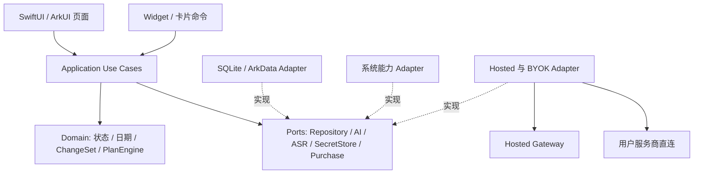

# 01 架构与模块边界

## 1. 架构决策

| ADR | 决策 | 原因与替换边界 |
|---|---|---|
| ADR-001 | 本地业务完整可运行，不引入登录前置 | 买断基础功能不依赖AI和云账户；Hosted匿名主体仅用于试用 |
| ADR-002 | 原生SwiftUI/ArkUI + 契约共享 | 系统语音、密钥、卡片与购买均需原生能力；跨平台替换只替UI/adapter，不能改变业务语义 |
| ADR-003 | 领域层按平台分别实现，同fixtures一致性验证 | 不把ArkTS视为完整Node/TS运行时；暂不引入FFI共享核心 |
| ADR-004 | SQLite逻辑模型 + Repository + 显式迁移 | 两端共享交换格式，不直接共享SQLite文件；wrapper在M02a选择 |
| ADR-005 | AI输出是提案，写入统一走命令 | 模型不可获得数据库、商店与SecretStore写权限；工具调用也不改变此约束 |
| ADR-006 | Hosted服务单体 + PostgreSQL账本 | 单人可维护；首版不用微服务、Kafka、分布式Agent、向量库 |
| ADR-007 | 平台按条件分阶段实现，系统入口后置 | 未确认Mac/真机能力不承诺双端同期；先领域fixtures，再第一个原生端，再复制同用例到另一端 |

ADR-002是本次默认实现路线；若后续跨平台Spike在目标SDK上验证了全套原生能力，可新建ADR替换，不把已有共享契约推倒重写。生产SDK、依赖与工具版本在各自适配器第一工作包固定为稳定版本与锁文件。

## 2. 组件与依赖方向



箭头表示编译依赖。D不引用UI、网络、系统时钟、平台SDK或SQL。Ports定义在Domain/Application的边界包，Adapter依赖它们；用组合根注入具体实现。图中的两条AI路线互斥选用，不构成自动fallback。

- Presentation：渲染view state、收集用户操作，不能直接更新数据库表。
- Application：读取快照、授权与确认、事务编排、调用ports、发布更新快照。
- Domain：纯规则与值对象，可注入Clock与ID生成器，所有行为可由fixtures重现。
- Adapter：平台/网络/存储细节。不要把HTTP状态码或某SDK异常暴露给页面。
- Gateway：仅Hosted身份、预算和模型调用，不接收用户全库、不承担V1同步。

## 3. 建议工程结构

```text
apps/ios/
  Packages/JarvisDomain/       # M01/M08纯规则
  Packages/JarvisApplication/  # 用例、ports、M06/M12/M14编排
  Packages/JarvisPersistence/  # M02
  Packages/JarvisAI/           # M05协议/路由，密钥由原生adapter注入
  JarvisApp/Features/          # M03/M04等页面
  JarvisApp/Adapters/          # ASR/Keychain/Purchase/Files
  JarvisApp/Composition/       # 唯一组合根
  JarvisWidgets/              # M15，可选target
apps/harmony/
  entry/src/main/ets/features/
  features/domain/            # ArkTS领域规则模块，包装方式在SDK Spike冻结
  features/application/
  features/persistence/
  features/platform/
services/hosted-gateway/
  src/modules/{identity,entitlements,trials,budget,ai,consent}/
contracts/{schemas,openapi}/    # 正式实现时由本套契约迁入
fixtures/{domain,repository,provider,plan,review,budget}/
qa/evidence/<build>/<platform>/<module>/
```

这是目标结构，不表示这些工程已经创建。iOS Swift Package、鸿蒙HAR等具体封装在M00后确定。卡片支持的HAR子集与App内部模块分开，不能把全业务模块打进卡片。

## 4. 公共接口（语言无关，非可直接编译的代码）

```text
Clock: nowInstant() -> Instant; localDate(zoneId) -> LocalDate
IDGenerator: next() -> UUID
UnitOfWork: run(expectedRevisions, commands) -> CommitReceipt
TaskRepository: get(id); list(filter,cursor,limit); readGraph(ids)
WorkspaceRepository: read(owner,cursor); search(query,cursor)
BackupPort: export(scope); previewImport(file); restore(previewToken)
SecretStore: store(origin,keyBytes)->KeyRef; use(KeyRef,operation); remove(KeyRef)
AIProvider: capabilities(); propose(AIRequest)->AsyncSequence<AIEvent>; cancel(requestId)
SpeechTranscriber: capabilities(locale); transcribe(session)->AsyncSequence<SpeechEvent>
PurchaseAdapter: getEvidence(); refreshFromUserAction(); observeChanges()
EntitlementVerifier: verify(platform,evidence)->VerifiedPurchase
PlanEngine: generate(PlanInput)->PlanDraft | PlanConflicts
SnapshotPublisher: publish(versionedSnapshot)->PublishResult
```

M01只定义业务需要的值/接口；M02具体实现UoW。`SecretStore.use`的含义是短生命周期将密钥提供给原生transport，不是把密钥塞进UI状态或业务DTO。真实SDK的签名可能不同，需满足同一语义。

读取一律分页（默认50、最大200为工程默认），使用稳定排序及id作为并列排序键；不能用当前页数量冒充全量数量。日期/枚举/错误code用稳定英文标识，展示文字本地化。

## 5. 组合与模块演示

每个模块提供 `DemoEntry + fixture seed + fake ports + scenario list`。Debug内部Demo菜单按模块打开；Release不包含fake购买解锁、假试用token、测试Key或可切换生产验签环境的入口。

| fake | 用法 | 不能替代的验证 |
|---|---|---|
| InMemoryRepository | 领域/页面/AI提案演示 | 实际数据库重启、迁移、事务 |
| ScriptedProvider | JSON/SSE/错误/取消 | 供应商能力、实际费用与大陆可用性 |
| FixedClock / SeededID | 日期、72h、计时与确定性排序 | 真机锁屏/重启/时钟变动 |
| FakePurchaseVerifier | 页面状态与协议 | 真购买、退款、签名与审核 |
| RecordedASR | 转写编辑与意图识别 | 系统模型、麦克风、噪声、权限 |
| FakeSecretStore | 配置UI与失败路径 | Keychain/Asset Store访问控制 |

Demo seed必须单独命名空间，不能污染真实个人数据库。禁止在真实数据库启动时自动清空或重置数据来“保证演示成功”。

## 6. 跨模块协作

用例读取不可变snapshot并带revision生成提案；领域命令提交后返回`CommitReceipt`（commitId、aggregate revisions、eventIds）。成功提交后应用层发布 `LocalDataChanged`，M08/搜索/Memory缓存/系统快照据此失效或更新。

该本地通知不充当持久化消息总线。进程中断后，各消费方通过数据库revision重建，不以“收到了通知”作为一致性前提。对Hosted账本结算使用数据库事务及持久状态，不复用本地通知。

禁止：M06调用M03页面；M15直接改Task.status列；M12直接插入日志绕过UoW；M09写试用时间；Provider删除任务；搜索索引成为唯一数据源。

## 7. 错误、取消与运行状态

统一错误：`errorId, code, category, retryable, messageKey, recoveryAction, details`，见[错误Schema](contracts/error.schema.json)。details仅允许明确列出的非敏感字段；页面按code渲染，不显示上游原始错误body。

| 类别 | 示例code | 恢复方式 |
|---|---|---|
| validation | INVALID_ARGUMENT / DEPENDENCY_CYCLE / PLAN_CONFLICT | 修改输入；不重试相同命令 |
| conflict | REVISION_CONFLICT / UNDO_CONFLICT | 刷新快照，重新展示差异并确认 |
| storage | STORAGE_FULL / MIGRATION_FAILED / BACKUP_INVALID | 保留草稿；释放空间/恢复，不删原库 |
| permission | MICROPHONE_DENIED / CONSENT_REQUIRED / SECRET_LOCKED | 用户主动授权或改为文字/解锁 |
| provider | PROVIDER_AUTH / RATE_LIMITED / MODEL_UNAVAILABLE / OUTPUT_INVALID | 修配置/等待/保留原文；不静默切路由 |
| entitlement | PURCHASE_UNVERIFIED / TRIAL_EXPIRED / BUDGET_EXHAUSTED | 重验购买/显式选择BYOK/继续基础版 |
| transport | NETWORK_UNAVAILABLE / REQUEST_TIMEOUT / CANCELLED | 保留输入；按策略重试或重取结果 |

业务取消不隐含回滚已经提交的本地事务，也不保证上游未计费。UI区分`idle / preparing / processing / awaitingConfirmation / saving / succeeded / failed / cancelled`，重试沿用原inputId；Hosted沿用同requestId重取而非重复扣款。

## 8. 非功能约束

字符串长度按Unicode标量对齐（Swift不能直接用grapheme的String.count代替）；原生序列化/JSON Schema的emoji与组合字符向量必须一致。

核心数据不依赖AI在线；App启动不索取麦克风或强制注册；首次第三方AI传输前单独说明数据去向并取得同意。日志白名单仅记operation/error code、延迟、技术版本；默认不记任务标题、转写、附件、Key、凭证。

工程首轮目标：基准真机普通操作可见反馈p95≤100ms、持久化p95≤300ms、1万任务分页首屏≤1.5s；属于待测目标，未达时先检查分页/主线程/查询，再修订目标。不能为追求即时反馈提前显示未提交的“保存成功”。
